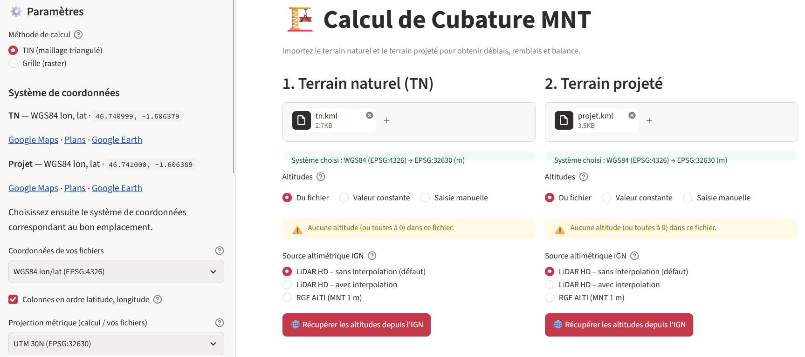

# 🏗️ Cubature MNT

Calcul de cubatures (déblais / remblais) entre deux modèles numériques de terrain (MNT) définis par des nuages de points topographiques — avec interface web Streamlit, en français.

**🚀 Application en ligne** : [cubature-mnt.streamlit.app](https://cubature-mnt-ywqyaueuwtjfzc8jtto92z.streamlit.app/) — aucune installation nécessaire.



## Fonctionnalités

### Import des données
- Fichiers **CSV / TXT / KML** (points, lignes ou polygones pour le KML)
- Séparateur (`,` `;` tabulation, espace), virgule ou point décimal, en-tête facultatif (même commenté par `#`) : **détectés automatiquement**
- Colonnes reconnues par leur nom (Est/X/E/lon…, Nord/Y/N/lat…, Altitude/Z/h…) ; à défaut, les 3 dernières colonnes sont lues comme Est, Nord, Altitude
- Altitudes : du fichier, **valeur constante** (plateforme plane), ou **saisie manuelle** point par point (≤ 5 000 points)
- Métriques de contrôle : nombre de points, altitudes min/max, surface XY (enveloppe convexe) et surface XYZ (développée)

### Systèmes de coordonnées
- **Détection automatique** WGS84 lon/lat vs coordonnées projetées (heuristique), avec choix manuel possible
- Conversions WGS84 → projection métrique pour le calcul : UTM automatique, Lambert-93, CC47, UTM 30N/31N/32N ou tout code EPSG
- **Zone de transformation complète (France)** : un point ou un fichier peut être converti entre
  Lambert-93, CC42 à CC50, anciens Lambert NTF (I, II, II étendu, III, IV), UTM 30N/31N/32N et WGS84
  - suggestion de la zone CC adaptée au point (bande de latitude)
  - avertissement sur la précision pour les changements de datum NTF ⇄ RGF93
- **Vérification de l'emplacement** : liens Google Maps / Plans / Google Earth sur la position supposée de chaque fichier, *avant* de valider le système de coordonnées

### Altitudes IGN (France)
Si un fichier WGS84 ne contient pas d'altitude (toutes à 0), l'application les récupère auprès du
[service de calcul altimétrique de l'IGN](https://geoservices.ign.fr/documentation/services/services-geoplateforme/altimetrie) (Géoplateforme) :

| Source | Description |
|---|---|
| **LiDAR HD – sans interpolation** (défaut) | altitude de la mesure LiDAR la plus proche |
| **LiDAR HD – avec interpolation** | valeur interpolée entre les mesures voisines |
| **RGE ALTI (MNT 1 m)** | MNT de référence IGN |

- Requêtes par paquets de 100 points, dans la limite de 5 requêtes/s imposée par le service
- Points hors couverture signalés (altitude à 0)
- Résultat mémorisé par fichier et par source pour la session

### Calcul de cubature
- **TIN** (maillage triangulé) : précis, suit la topographie réelle
- **Grille** (raster) : rapide sur de gros jeux de données, pas réglable de 0,5 à 5 m
- **Épaisseur de couche** : ajout (+) ou retranchement (−) d'une distance aux altitudes du TN et/ou du projet (ex. décapage de terre végétale)
- **Coefficients** : foisonnement des déblais, tassement des remblais, coût de transport (€/m³)
- Vérification du recouvrement des emprises avant calcul

### Résultats
- Déblais, remblais, balance (« Volume à évacuer » / « Volume à apporter »), volumes foisonnés/tassés, coût estimé, surface réellement calculée
- **Carte interactive** des déblais/remblais (zoom, survol) avec seuil d'écart négligeable réglable
- **Rapport CSV** téléchargeable : paramètres, modes d'altitudes, emprises et altitudes avec/sans épaisseur, et les 4 tables de points complètes (TN / Projet, avec / sans épaisseur)

## Formats acceptés

**Coordonnées projetées (mètres)**
```text
Est;Nord;Altitude
651234,50;6861234,25;102,35
651235,50;6861234,25;102,41
```

**WGS84 (degrés)** — `lon;lat;alt` ou `lat;lon;alt` (à cocher si colonnes inversées et sans en-tête)
```text
lon;lat;alt
2,352200;48,856600;35,20
```

**KML** : toujours WGS84 lon, lat, altitude (0 si absente → récupération IGN possible).

## Installation

Python 3.9+ requis.

```bash
pip install -r requirements.txt
streamlit run app.py
```

Dépendances principales : `streamlit`, `pandas`, `numpy`, `plotly`, `scipy`, `pyproj` (voir `requirements.txt`).

## Structure du projet

```text
app.py            # application web Streamlit
src/cubature.py   # calculs de cubature (TIN, grille, différences)
main.py           # interface en ligne de commande (ancienne version)
requirements.txt
```

## Déploiement

Le déploiement sur [Streamlit Community Cloud](https://share.streamlit.io/) se fait directement depuis ce dépôt GitHub : `app.py` comme point d'entrée, `requirements.txt` pour les dépendances.

## Licence

À définir (par ex. MIT) — voir avec l'auteur.
